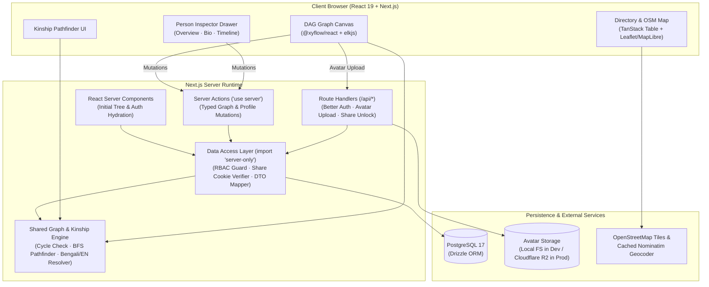
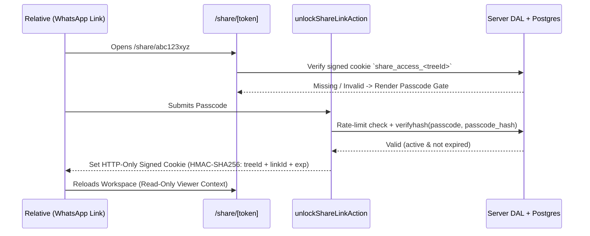

# Shikor (শিকড়) — System Architecture Document

**Product Name:** Shikor (`শিকড়` — *"Roots"*)  
**Architecture Style:** Modular Monolith (Full-Stack Next.js App Router)  
**Last Updated:** 2026-11-26  

---

## 1. High-Level System Overview

The platform is architected as a **type-safe Full-Stack Next.js App Router monolith** backed by **PostgreSQL** and **Drizzle ORM**. Keeping database schema, server authorization, graph algorithms, and interactive canvas components in a single TypeScript codebase eliminates DTO drift while remaining simple to self-host via Docker or deploy to cloud platforms (Vercel/Railway/Fly.io + managed Postgres + Cloudflare R2).



---

## 2. Technology Stack Decisions

| Component | Technology | Rationale |
| :--- | :--- | :--- |
| **App Framework** | Next.js (App Router, TypeScript) | Combines SSR/RSC fast reads with Server Actions for mutations and Route Handlers for binary uploads & auth endpoints. |
| **Database** | PostgreSQL 17 (Docker Compose) | Strong relational integrity, UUID primary keys, indexed lookups, and recursive CTE support for ancestor/descendant subgraphs. |
| **ORM & Migrations** | Drizzle ORM + `drizzle-kit` | Zero-overhead SQL generation, strict TypeScript inference, first-class CTE/join support, and built-in Drizzle Studio. |
| **Authentication** | Better Auth | Runs directly against our PostgreSQL database (no per-MAU vendor lock-in), supporting Email/Password and Google OAuth. |
| **Graph Engine** | `@xyflow/react` + `elkjs` | `d3.hierarchy` fails on multi-parent DAGs (cousin marriages, in-law branches). `elkjs` (`layered` algorithm) computes clean multi-generation DAG coordinates with marriage/union junction nodes, rendered interactively by React Flow. |
| **Table & Map** | `@tanstack/react-table` + `react-leaflet` / `maplibre-gl` | Instant client-side multi-faceted filtering for trees up to thousands of rows + zero-API-key OpenStreetMap rendering. |
| **Validation & Forms** | `zod` + `react-hook-form` | Single source of validation schemas shared between client forms and `"use server"` actions. |
| **Styling & UI** | Tailwind CSS + `shadcn/ui` + `lucide-react` | Accessible drawers, dialogs, command palettes (`cmdk`), and clean typography (`Inter` + `Noto Sans Bengali`). |

---

## 3. Repository & Module Structure

```text
family/
├── docker-compose.yml              # Local PostgreSQL 17 service + persistent volume
├── drizzle.config.ts               # Drizzle Kit migration & studio config
├── docs/
│   ├── PRD.md                      # Product Requirements Document
│   ├── ARCHITECTURE.md             # System Architecture Document
│   └── db.sql                      # Legacy v1 MariaDB dump (seed input; gitignore secrets)
├── scripts/
│   └── seed-from-legacy-sql.ts     # Deterministic parser & importer for docs/db.sql
└── src/
    ├── app/                        # Next.js App Router routes
    │   ├── (marketing)/            # Landing page & sign-in / sign-up
    │   ├── (dashboard)/
    │   │   ├── trees/              # Multi-tree workspace selector & creation
    │   │   └── trees/[slug]/       # Main Tree Workspace (Graph | Directory | Map | Kinship)
    │   ├── share/[token]/          # Passcode gate & read-only shared tree workspace
    │   └── api/
    │       ├── auth/[...all]/      # Better Auth handler
    │       ├── uploads/avatar/     # Local/R2 avatar upload handler
    │       └── geocode/            # Rate-limited & DB-cached city/country geocoder
    ├── components/
    │   ├── graph/                  # React Flow canvas, PersonNode, UnionNode, Hourglass controls
    │   ├── person-drawer/          # Slide-over inspector (Overview, Bio, Timeline, Quick-Add)
    │   ├── directory/              # TanStack Family Directory & Blood Group filter bar
    │   ├── map/                    # OpenStreetMap diaspora cluster map
    │   ├── kinship/                # 2-person relationship calculator & path cards
    │   └── ui/                     # shadcn/ui primitives
    ├── db/
    │   ├── index.ts                # PostgreSQL pool + Drizzle client
    │   ├── schema/                 # Modular Drizzle table definitions (auth, trees, genealogy)
    │   └── migrations/             # Generated SQL migrations
    ├── lib/
    │   ├── auth.ts                 # Better Auth server config
    │   ├── auth-client.ts          # Better Auth React client
    │   ├── graph-layout/           # DAG -> ELK graph builder & Hourglass subgraph filter
    │   ├── kinship/                # Bidirectional BFS + English & Bengali kinship rules
    │   ├── storage/                # Pluggable LocalFS / S3 (Cloudflare R2) storage adapter
    │   └── validations/            # Shared Zod schemas (fuzzy dates, persons, unions, events)
    └── server/
        ├── dal/                    # `import 'server-only'` Data Access Layer (Authz + Queries)
        └── actions/                # Thin `"use server"` actions calling DAL + revalidatePath
```

---

## 4. Database Schema & Modeling Details

### 4.1 Core Domain Tables

1. **Identity & Access (`users`, `sessions`, `accounts`, `verifications`)**
   - Managed by Better Auth in PostgreSQL.

2. **Workspaces & Sharing (`family_trees`, `tree_members`, `tree_share_links`)**
   - `family_trees`: `(id, name, slug, description, default_root_person_id, created_by_id, created_at, updated_at)`
   - `tree_members`: `(id, tree_id, user_id, role ['owner' | 'editor' | 'viewer'], claimed_person_id, joined_at)`
     - Unique constraint on `(tree_id, user_id)`.
     - `claimed_person_id` optionally references `persons(id) ON DELETE SET NULL` for *"This is me"*.
   - `tree_share_links`: `(id, tree_id, token [unique], label, passcode_hash, is_active, expires_at, last_accessed_at, created_by_id, created_at)`

3. **Genealogy Graph (`persons`, `partnerships`, `parent_child_links`)**
   - `persons`:
     - Identity: `id (uuid)`, `tree_id`, `legacy_id (int, nullable)`, `display_name`, `full_name`, `nickname`, `native_name`, `is_name_unknown (bool)`, `placeholder_label`, `gender ('M'|'F'|'O'|'U')`, `avatar_url`.
     - Vitals & Fuzzy Dates: `is_living (bool)`, `birth_date_precision`, `birth_date`, `birth_year`, `birth_date_text`, `death_date_precision`, `death_date`, `death_year`, `death_date_text`, `sibling_order (int)`, `is_twin (bool)`.
     - Directory & Story: `blood_group`, `occupation`, `education`, `bio_markdown`, `nationality`, `birth_place`, `current_city`, `current_country`, `latitude`, `longitude`, `contact_phone`, `contact_email`.
   - `partnerships`:
     - `(id, tree_id, partner1_id, partner2_id, status ['married'|'divorced'|'widowed'|'separated'|'engaged'], marriage_order, start_date_precision, start_date, start_year, start_date_text, end_date_text, notes)`
     - Solves childless marriages, remarriages, and union-node rendering.
   - `parent_child_links`:
     - `(id, tree_id, parent_id, child_id, partnership_id [nullable], lineage_type ['biological'|'adoptive'|'step'|'foster'], parent_role ['father'|'mother'|'parent'])`
     - Unique constraint on `(parent_id, child_id, lineage_type)`.
     - Before inserting/updating any link, the DAL executes **DAG cycle detection** (ensuring `parent_id` is not already a descendant of `child_id`).

4. **Biographical Timeline & Geocoding Cache (`life_events`, `geocache`)**
   - `life_events`: `(id, tree_id, person_id, event_type, title, description, date_precision, event_date, sort_year, date_text, location, created_at)`
   - `geocache`: `(query_key PK, latitude, longitude, display_label, updated_at)` — caches `"dhaka, bangladesh"` coordinates in Postgres so OpenStreetMap Nominatim is queried at most once per unique city/country across the entire platform.

---

## 5. Visualization & DAG Layout Pipeline (`@xyflow/react` + `elkjs`)

### Why Not `d3.hierarchy`?
`d3.hierarchy` requires a strict mathematical tree (single parent per node). In `docs/db.sql`:
- Children have **two parents** (`father_id` + `mother_id`).
- Spouses can bring **in-law ancestors** (e.g., `In-Law Root #29` → `Spouse Parent #30` marrying `Descendant #14`).
- Relatives marry **cousins within the same tree** (`Member #123` + `Member #103`, both descendants of `Root Ancestor #1`).

### Two-Node-Type Bipartite Family DAG
We model the visual graph with two React Flow node types:
1. **`PersonNode` (220×88px card):** Avatar/initials, display name + *daknam* / বাংলা subtitle, birth–death year pill or Living indicator, blood group badge, kinship pill, and hover `+` quick-add handles.
2. **`UnionNode` (compact marriage pill):** Represents a `Partnership`.
   - Edges flow `Partner 1 ──► UnionNode ◄── Partner 2` (same rank/layer preference).
   - Children flow `UnionNode ──► Child PersonNode` (sorted left-to-right by `sibling_order` / `birth_year`).
   - Single-parent children without a recorded partnership connect via an implicit single-parent union hub or direct `Parent ──► Child` edge, styled by `lineage_type` (solid line for `biological`, dashed badge for `adoptive` / `step` / `foster`).

### View Modes on the Canvas
- **Full Tree Mode:** Lays out the connected component(s) with collapsible union/branch toggles.
- **Hourglass Focus Mode:** Given `focusPersonId`, extracts:
  - **Upward traversal:** All ancestors (biological/adoptive) up to root(s).
  - **Immediate ring:** Spouses and siblings of the focus person.
  - **Downward traversal:** All descendants and their spouses.
  - Re-runs `elkjs` layout in <30ms client-side with smooth viewport centering.

---

## 6. Cultural Kinship Engine (`src/lib/kinship/`)

### Step 1: Bidirectional BFS Pathfinding
Treat the family graph as an undirected labeled multigraph where edges are:
- `PARENT` (`child -> parent`, annotated with parent's `gender` and `lineage_type`)
- `CHILD` (`parent -> child`, annotated with child's `gender` and `lineage_type`)
- `SPOUSE` (`partner1 <-> partner2`, annotated with `status`)

Given `(sourcePersonId, targetPersonId)`:
1. Run BFS to find shortest simple path(s) up to depth 16.
2. Compress consecutive `PARENT` followed by `CHILD` through a shared parent/union into `SIBLING` (`full` vs `half`).

### Step 2: English & Bengali (`বাংলা`) Pattern Resolver
Translate the compressed edge-signature vector into structured output:
```ts
interface KinshipResult {
  englishTerm: string;          // e.g. "Paternal Aunt" | "Maternal First Cousin (Male)"
  bengaliTranslit?: string;     // e.g. "Fupu"          | "Mamato Bhai"
  bengaliScript?: string;       // e.g. "ফুপু"          | "মামাতো ভাই"
  lineageNote?: string;         // e.g. "via adoptive link" or "Double relation (paternal & maternal)"
  pathNodeIds: string[];        // Highlighted on the React Flow canvas
  pathEdgeIds: string[];
}
```
Covers direct ancestors/descendants (*Baba/Ma, Dada/Dadi, Nana/Nani, Chele/Meye, Nati/Natni*), paternal vs. maternal uncles/aunts & their spouses (*Chacha/Chachi, Jetha/Jethi, Fupu/Fupa, Mama/Mami, Khala/Khalu*), cousins (*Chachato, Fupato, Mamato, Khalato Bhai/Bon*), sibling-in-laws (*Bhabi, Dulabhai, Shala/Shali, Debor/Nanod*), niblings (*Bhatija/Bhatiji, Bhagina/Bhagni*), and generic generational fallbacks (*e.g., 2nd Cousin once removed*) when outside classic named terms.

---

## 7. Security, Authorization & Passcode Share Flow

All reads and writes pass through `src/server/dal/` (`import 'server-only'`):



### Permission Matrix

| Capability | Passcode Guest | Tree `Viewer` | Tree `Editor` | Tree `Owner` |
| :--- | :---: | :---: | :---: | :---: |
| View Graph, Directory, Map, Bios & Timelines | Yes | Yes | Yes | Yes |
| Use Kinship Calculator | Yes | Yes | Yes | Yes |
| Claim `"This is me"` Profile Node | No | Yes | Yes | Yes |
| Add / Edit / Delete Persons, Unions & Events | No | No | Yes | Yes |
| Upload Profile Avatars | No | No | Yes | Yes |
| Manage Collaborators & Passcode Share Links | No | No | No | Yes |
| Rename / Delete Family Tree | No | No | No | Yes |

---

## 8. Legacy `docs/db.sql` Seed Pipeline

`scripts/seed-from-legacy-sql.ts` runs idempotently (`pnpm db:seed:legacy`):
1. Parses `INSERT INTO FamilyBranch_person VALUES (...)` from `docs/db.sql` without requiring MariaDB to be installed.
2. Normalizes names:
   - Regex `^(.+?)\s*\(([^)]+)\)$` on regular names extracts nickname (`"Ayesha (Sunny)"` → `display_name: "Ayesha"`, `nickname: "Sunny"`).
   - Regex matching `N/A` marks `is_name_unknown = true` and cleans `"N/A (2nd Son)"` → `placeholder_label: "2nd Son"`.
3. Deduplicates all `(father_id, mother_id)` pairs where both exist to create `partnerships` (`status: 'married'`) and attaches child `parent_child_links` to both parents and the union.
4. Computes generation depth from root ancestors (`#1`, `#2`, etc.) to assign realistic initial `is_living` defaults (generations ≥ 5 marked `is_living = true`, older generations marked `is_living = false` unless overridden).
5. Seeds a fresh local owner user (`john@mail.app` / configurable via `.env`).
